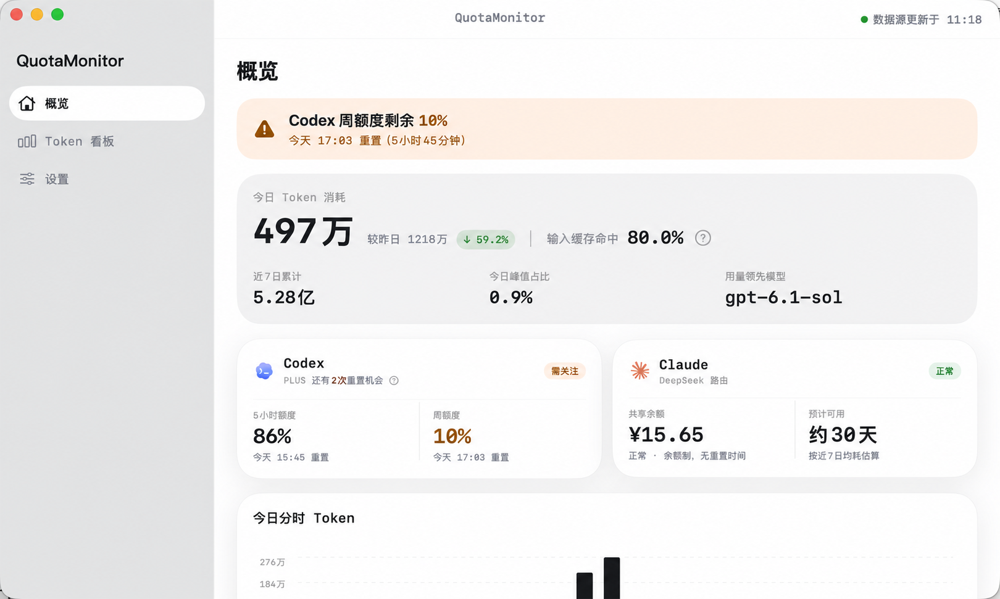
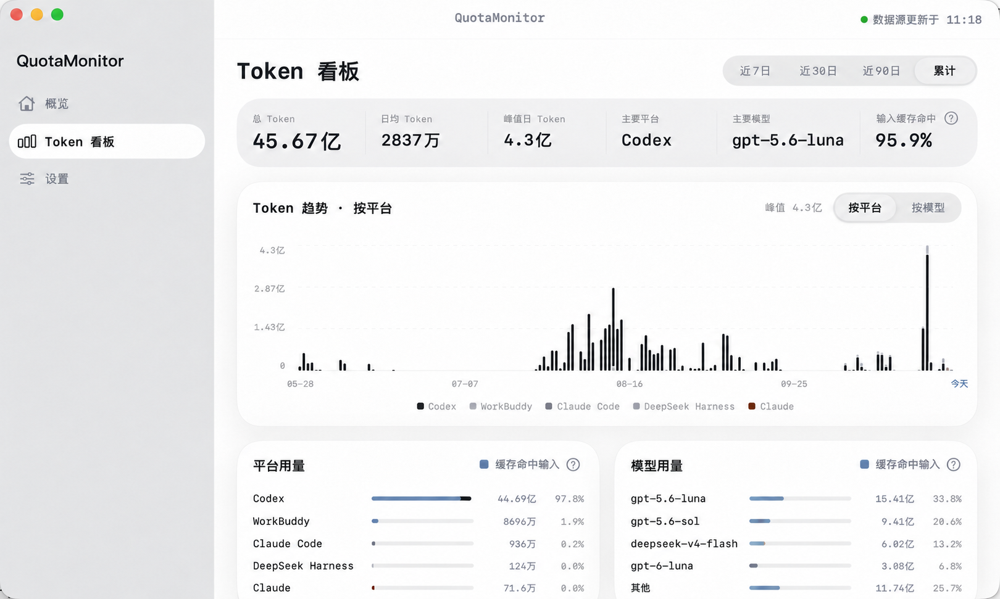
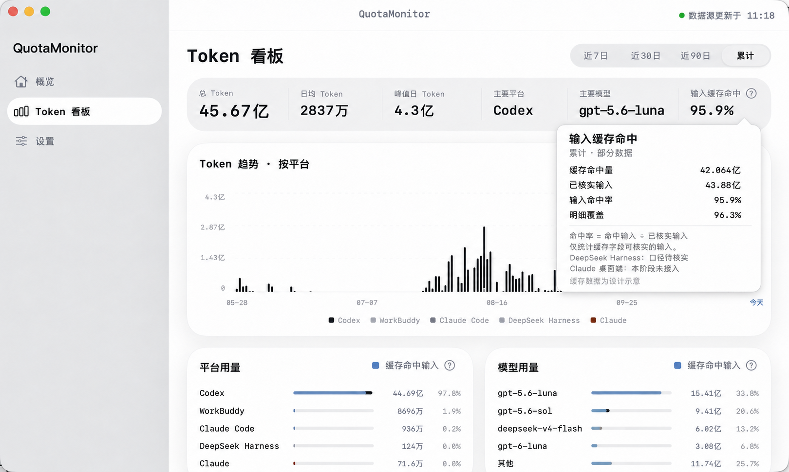

# 输入缓存命中：交互与视觉设计草案 v2

> 对应 QMT-010；此文档保留 2026-11-04 设计稿及后续审稿过程，不单独代表当前实现。最终交互以本文末尾修订与 [acceptance.md](acceptance.md) 的实机验收为准。

2026-11-04 用户确认第二版设计方向并授权开始实现。以下图片为审稿效果图，缓存数值为示意；真实界面验收仍待完成。

## 1. 已确定的方向与历史

用户要求：概览的缓存率放在昨日比较后方；Token 顶部五项压为六项；移除独立缓存容器，利用平台 / 模型用量横条表达命中输入；部分数据等解释用问号点击弹框。

[第一轮设计](design-v1-superseded.md)已标 superseded，保留用户审稿前的决策记录。当前 Spec / Plan / 追踪项以本轮方向为准，图片仍待用户审核，不因此变为 accepted。

模式为 Operate。现有 OverviewPageView、TokenPageView 和 PanelTheme 为视觉依据；窗口、侧栏、卡片、数字层级与趋势图位置保持原结构。本轮只制作图片并更新文档，不改应用代码。

## 2. 概览：把一项辅助信息放回比较行

    今日 Token 消耗
    497万   较昨日 1218万  [↓59.2%]  |  输入缓存命中 80.0%  (?)

    近7日累计               今日峰值占比             用量领先模型
    5.28亿                  0.9%                     gpt-6.1-sol

- 缓存标签为灰色、百分比为主文字色，中间只用轻分隔和原有组间留白；不复制昨日的绿色涨跌徽标。
- 不新增行、缓存卡、命中量、部分数据徽标或“查看明细”按钮；正常宽度不增加原卡高度。
- 现有右侧留白容纳缓存组。最小窗口先收紧组间距；确实不足时缓存组整体换行，不缩小 497万 主数字。
- 问号是灰色圆圈内的 ?，可点击 / 键盘操作；辅助功能名包含“今日缓存说明”及完整 / 部分 / 过期状态，不能仅显示没有名称的图标。

## 3. Token 顶部：原灰条六等分

    总Token | 日均Token | 峰值日Token | 主要平台 | 主要模型     | 输入缓存命中 (?)
    45.67亿 | 2837万    | 4.3亿       | Codex    | gpt-5.6-luna | 95.9%

- 在同一灰色指标条末尾增加第六项，等分列宽，适度收紧内边距；数值沿用原有字号层级及等宽基线，不把新比例放大成第二主指标。
- 标题允许必要的两行；长模型名允许在既有可读字号下适配，不能为了六等分截断关键模型名。默认和最小窗口均待实测。
- 取消上一版缓存容器、原位展开、独立来源表及“今日 / 跟随看板”状态；趋势图与原排行卡不因新增缓存功能下移。
- 全局缓存率与问号弹框跟随近7日 / 近30日 / 近90日 / 累计。概览问号只解释今日，不跨页跳转。

## 4. 平台 / 模型横条：同一条里的组成

保留原有标题、排序、Token 数、右侧占比与整条已填充长度。仅在已填充部分内部用蓝灰色标出可核实的缓存命中输入，余下部分沿用原条色；未填充轨道保持现有浅灰。

    平台用量                         ■ 缓存命中输入 (?)
    Codex              [蓝灰命中段 | 原色其余段    ]  44.69亿  97.8%
    WorkBuddy          [蓝灰 | 其余]                   8696万   1.9%
    DeepSeek Harness   [原色，无缓存证据]              124万    0.0%

图例的蓝灰色是组成类别，不是“达标”。平台与模型卡都复用相同颜色和点击问号，不再增加缓存百分比列或额外说明行。来源 / 模型行具有点击和键盘说明入口，普通悬停可补提示，但不是唯一获取途径。

### 三个分母不能混淆

- 原条长与右侧占比：该行总 Token / 同组全部 Token。
- 蓝灰段在该行已填充条内部的比例：该行可核实命中输入 / 该行总 Token。
- 输入缓存命中率：该行可核实命中输入 / 该行合格输入，只在全局指标和对应说明弹框中明确显示。

例：一行输入100、命中80、输出100，输入命中率80%，但蓝灰段只能占这行已填充条的40%。把80%直接画进原总Token条会夸大命中输入的实际组成。

原色其余段包含普通输入、缓存写入、输出，以及缓存信息不明的部分；不叫“全部未命中”。没有证据时整条保留原色，点击显示“未知 / 未纳入”，不能显示0%命中。部分覆盖只着色已核实命中；真正零命中通过弹框文字与未知区分。

“其他”模型组沿用现有成员，合并计数再计算，不能平均各模型百分比。极小命中段不强行设置最小宽度；0蓝段不得为便于点击而涂出颜色，整行仍可访问。

## 5. 点击问号：原生锚定弹框

不显示屏幕居中的模态对话框，也不遮罩全屏。弹框锚定对应问号，采用原生 popover，自动避开窗口边缘，内容多时在弹框内滚动。

指标问号弹框包含：

    输入缓存命中
    累计 · 部分数据

    缓存命中量        42.064亿
    已核实输入        43.88亿
    输入命中率        95.9%
    明细覆盖          96.3%

    命中率 = 命中输入 ÷ 已核实输入
    仅统计缓存字段可核实的输入。
    未纳入原因 / 数据更新时间

概览弹框标题范围为今日。平台 / 模型标题旁问号解释两段颜色、原右侧占比与两个分母；点击具体行只展示该行范围、总Token、合格输入、命中输入、输入命中率、覆盖与未纳入原因。原色余段不被标成未命中。

部分 / 未知 / stale / 扫描中 / 旧缓存信息集中在此，默认页面不额外堆徽标。完全无可核实输入时主指标仍显示 —，不能为了简洁而显示正常0%。过期旧值若显示须带“上次”标识；不隐藏失败来源或把其混入新鲜合计。

点击按钮打开；再点按钮、点击外部或 Esc 关闭。打开后焦点进入弹框，关闭回到触发按钮；切换周期时关闭弹框，避免旧内容漂在新指标上。只开关说明不触发扫描、不新增持久偏好。

## 6. 颜色、尺寸、文案与无障碍

沿用 docs/DESIGN_SYSTEM.md 的实色卡片、圆角、字体、分隔线和原生弹框。只计划新增 cacheRead 语义色：浅色为低饱和蓝灰（审稿图参考 #6886A3），深色需适当提亮并单独验收。它表达缓存读取，不借用 Codex 品牌色，也不映射 ok / danger。

中英文关键名称：

| 中文 | English |
| --- | --- |
| 输入缓存命中 | Input cache hit rate |
| 缓存命中输入（条段图例） | Cached input |
| 其余 Token（含未核实部分） | Other tokens (including unverified data) |
| 缓存说明 | Cache details |
| 已核实输入 | Input with verified cache data |
| 明细覆盖（按总 Token） | Detail coverage (by total tokens) |
| 部分数据 / 口径待核实 | Partial data / Semantics unverified |
| 未知 / 上次记录 | Unknown / Last recorded |

- 先检验980×620与820×540 pt、浅深色、中英文，尤其六列模型名与概览比较行。图片只覆盖浅色正常窗口，不能宣称小窗或英文通过。
- 原条未填充轨道可短，但未知不能用零代替。蓝灰段小于一个像素时靠文字说明精确数量，不夸大面积。
- 问号与排行行 Tab 可达，Enter / Space 打开、Esc关闭；点击区域大于图标本身。VoiceOver 朗读范围、分母、命中率和状态，不要求用户辨色。
- 不做数字增长、填充条动画或评分提示；沿用系统弹框动效及减少动态效果设置。

## 7. 审稿示意数据与待验

概览示意：有效输入400万、命中320万、对应有效记录总量404万，整页今日497万。累计示意：合格输入43.88亿、命中42.064亿、有效记录总量43.991亿、已采集45.67亿，命中率约95.9%、覆盖约96.3%。

示意来源：Codex命中41.28亿 / 总量44.69亿，WorkBuddy命中7200万 / 总量8696万，Claude Code命中640万 / 总量936万；这些分段占比与各自输入命中率不同。所有新增缓存值都是图片审稿数据，未重新采集或验收为用户实际用量。

本轮仅图片与文档审稿。真实格式、部分覆盖、无输入、异常、stale、两种分母、模型其他分组、popover定位、键盘与小窗口均保留待验。价格阶段仍 deferred；不从缓存率推导节省金额。

## 2026-11-08 审稿修订：轻量说明与 hover

本节替代前文关于缓存说明内容及排行点击弹框的要求，计算、来源准入与数据证据规则继续有效。

- 问号只解释“输入中复用缓存的比例，按输入 Token 计算，不含输出”。有部分数据时补一句“仅统计可核实的数据，部分记录未纳入”；无值或刷新时显示对应短状态。移除数字复述、覆盖率公式、更新时间、来源表和原因清单。诊断证据仍保存在数据模型与验收记录中。
- 平台 / 模型用量行不再作为点击按钮，不打开原生说明弹框。hover 出现小浮层：名称、输入缓存命中率；仅部分覆盖时一行“仅含可核实输入”，未知时明确无缓存数据。移开即隐藏。
- 浮层复用现有图表 tooltip 的字体、实色表面、描边和阴影，在排行卡外绘制，不能被卡片裁切。
- 键盘聚焦同行时提供相同内容；关闭系统蓝色焦点框，用轻微中性底色标识焦点，Escape 移除焦点浮层。切周期重置行交互状态。辅助功能直接读取率与部分覆盖状态。
- 验收：问号两三行可读；hover 无点击、无持久选中、无蓝框、无审计表；未知不显示 0%；平台 / 模型 / 其他沿用原统计成员与分母。

## 2026-11-08 第二次交互审稿（覆盖前述交互要求）

- 所有主面板页面及下拉组件取消系统蓝色点击 / 焦点边框；SwiftUI 焦点效果与原生 AppKit focus ring 均抑制。原键盘操作保留，排行条目例外：仅 hover，无点击、聚焦、固定或键盘查看状态。
- 缓存问号在主面板内部以受边界约束的 overlay 展示；点击外部或 Escape 关闭，不再使用可能越出窗口的系统 popover。
- 平台 / 模型排行标题右侧缓存图例和问号全部移除。原用量条恢复原分类色，不再绘制蓝灰缓存子段。
- hover 当前行保持原亮度，其他排行行降低透明度；移开恢复。小浮层只展示命中率和原色圆点、名称、缓存命中量，未知显示 —，不显示“仅含可核实输入”等说明。
- 缓存计算、准入、缺失不当零等规则保持。2026-11-08 来源语义复核后，Claude Desktop 与 DeepSeek Harness v4 已准入；具体归一规则见 [Spec 的来源语义核实](spec.md#2026-11-08-来源语义核实及准入更新)。

## 2026-11-08 Hover 文案与字体

- 浮层采用 Token 图表 tooltip 的等宽字体等级：标题 10 pt、百分比 11 pt、名称与 token 数 9 pt。

## 2026-11-08 移除行间缓动

- 相邻行之间直接切换选中态，不对透明度或 tooltip 做缓动动画。离开后保留 80 ms 清除窗口，仅用于跨入相邻行时避免短暂无 hover 状态。
- 名称明确使用 9 pt 等宽字号，避免继承系统默认字号。
- 两行分别显示“输入缓存命中率 + 比例”与“平台 / 模型名称 + 命中 Token/输入 Token”。
- 逐行 hover 通过 80 ms 交接延迟避免相邻行间闪回；不对透明度或 tooltip 增加缓动。

## 2026-11-08 问号弹框统一

- 缓存说明与 Codex 可用重置次数共用 `PanelHelpButton` 和主面板浮层，统一点击、焦点环、点击外部关闭与 Escape 关闭行为。
- 弹框锚定问号按钮，样式与交互统一；缓存说明在靠近内容栏右侧时从触发点向左展开，避免越过内容模块右边界。
